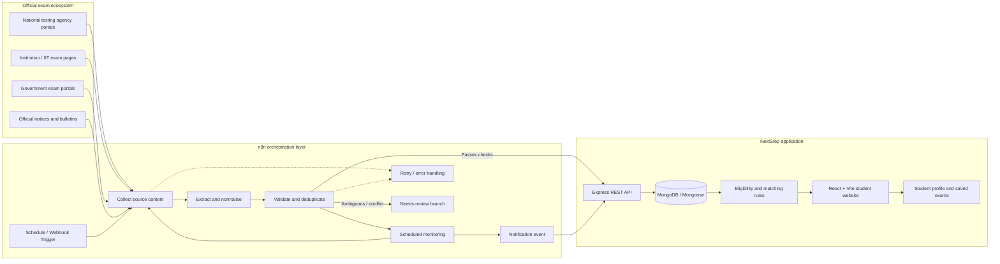
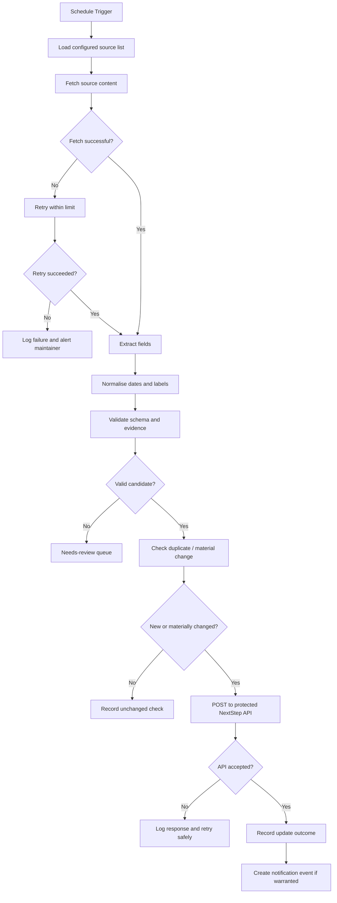

# NextStep — Never Miss an Exam Deadline

<p align="center">
  <strong>A personalised exam-discovery platform for students in India</strong><br/>
  Discover relevant exams. Verify official details. Track deadlines before they pass.
</p>

<p align="center">
  <em>Proposed n8n automation integration · Hackathon architecture</em>
</p>

<p align="center">
  <a href="#the-problem">Problem</a> ·
  <a href="#how-nextstep-works">How it works</a> ·
  <a href="#proposed-n8n-integration">n8n integration</a> ·
  <a href="#architecture">Architecture</a> ·
  <a href="#data-quality-and-trust">Data quality</a> ·
  <a href="#roadmap">Roadmap</a>
</p>

> **Status:** NextStep is an exam-discovery product with a proposed n8n-powered automation layer. The workflows below describe the intended hackathon integration; they should be labelled as proposed until the corresponding n8n workflows, credentials, and end-to-end tests are deployed.

---

## Contents

- [The problem](#the-problem)
- [Our solution](#our-solution)
- [Who NextStep serves](#who-nextstep-serves)
- [How NextStep works](#how-nextstep-works)
- [Why n8n](#why-n8n)
- [Proposed n8n integration](#proposed-n8n-integration)
- [End-to-end workflow](#end-to-end-workflow)
- [Architecture](#architecture)
- [Workflow breakdown](#workflow-breakdown)
- [Data quality and trust](#data-quality-and-trust)
- [Student experience](#student-experience)
- [Technology stack](#technology-stack)
- [Repository structure](#repository-structure)
- [Local development](#local-development)
- [Configuration](#configuration)
- [Security and responsible automation](#security-and-responsible-automation)
- [Testing and acceptance criteria](#testing-and-acceptance-criteria)
- [Failure handling and observability](#failure-handling-and-observability)
- [Hackathon demo plan](#hackathon-demo-plan)
- [Expected impact](#expected-impact)
- [Limitations](#limitations)
- [Roadmap](#roadmap)
- [Contributing](#contributing)

---

## The problem

### Students do not just need more exam information. They need the right information before the deadline.

India has a wide range of entrance examinations, Olympiads, scholarships, university admissions, and government recruitment examinations. Their official announcements are spread across different institutional websites, notices, information bulletins, and PDF documents. Each portal publishes information in its own format and on its own schedule.

For a student, this creates a very specific failure mode: **an eligible student can miss an exam because they did not discover the notification in time, misunderstood an eligibility condition, or failed to notice that an application deadline had changed.**

| Real student problem | Why it happens | What NextStep aims to do |
|---|---|---|
| A student discovers an exam after registration has closed | Notifications are distributed across many official portals | Collect and monitor selected official sources on a schedule |
| A student sees an exam but cannot tell whether they qualify | Eligibility may be buried in a long bulletin or PDF | Extract eligibility fields and flag unclear or conflicting information for review |
| A student in Class 10 is shown exams intended for graduates | Exam listings may not consistently represent minimum and maximum education levels | Match exam eligibility against the student's profile and explicit education-level bounds |
| An application date changes after a student has saved an exam | Students may not revisit the official portal every day | Recheck sources and surface verified changes |
| A student relies on a forwarded message or unofficial post | Social posts can be outdated, incomplete, or detached from the original notice | Keep the official source link and evidence alongside each exam record |
| A student has to check the same portals repeatedly | There is no single, personalised place to review relevant exam notices | Bring relevant exams, dates, eligibility, and official links into one discovery experience |

The core problem is not a lack of ambition or a lack of exams. It is the **gap between official exam information being published and an eligible student acting on it before the deadline**.

### Why this matters

An exam deadline is time-sensitive. A listing that is accurate but discovered too late is not useful to the student who needed it. NextStep therefore treats freshness, eligibility, source evidence, and deadline awareness as core product concerns—not optional extras.

---

## Our solution

**NextStep is a personalised exam-discovery platform for students in India.** A student provides relevant academic details, such as their education level, stream, subjects, and interests. NextStep uses those details to help surface exams that may fit their current stage and presents the information students need to decide what to do next.

The proposed n8n integration adds an automation layer around the exam-information lifecycle:

1. **Discover** official exam pages and notices from configured sources.
2. **Collect** source content and relevant links on a schedule or through a webhook-triggered run.
3. **Extract and normalise** exam names, eligibility, application dates, fees where published, and official URLs into a consistent candidate record.
4. **Validate** required fields, education-level bounds, source evidence, duplicate records, and date consistency.
5. **Review exceptions** instead of silently guessing missing or contradictory facts.
6. **Update** verified records in the NextStep backend/database through a controlled API.
7. **Monitor** sources for new notices and changes to previously captured information.
8. **Notify** students about relevant verified updates and approaching deadlines, using the notification channels that are actually configured.

n8n coordinates the workflow. It does not replace NextStep's backend, database, eligibility rules, or user interface. The backend remains the source of truth for application data and student-facing exam records.

---

## Who NextStep serves

NextStep is designed around **exams and academic opportunities with formal eligibility and application timelines**, from school-level examinations through undergraduate and postgraduate entrance exams and relevant government examinations.

Examples of source categories that can be configured include:

- National testing agencies and official entrance-exam portals
- IIT and other institution-specific examination/admission pages
- Government examination and recruitment portals
- Olympiad and scholarship examination websites
- Official notices, information bulletins, and application PDFs

The exact sources included in a production run must be explicitly configured and reviewed. A source category is not a claim that every institution has already been integrated.

### Personalised matching

The intended matching inputs include:

- Current education level
- Stream and relevant subjects
- Academic interests
- Other eligibility fields supported by the existing profile and exam schema

The matching layer should use explicit eligibility bounds wherever available. For example, an exam limited to students who have completed Class 12 should not be recommended to a Class 8 student merely because both records contain a broad category such as “school student.”

**Important scope boundary:** NextStep is an exam-discovery product, not a jobs or internships aggregator. n8n automates the collection and monitoring of exam information; it does not make the product “AI-powered” by default. Deterministic parsing, validation, matching, and human review are preferred wherever they are sufficient.

---

## How NextStep works

<CodeBlock language="mermaid" editable>
flowchart TD
    A["Schedule Trigger"] --> B["Load configured source list"]
    B --> C["Fetch source content"]
    C --> D{"Fetch successful?"}
    D -- "No" --> E["Retry within limit"]
    E --> F{"Retry succeeded?"}
    F -- "No" --> G["Log failure and alert maintainer"]
    F -- "Yes" --> H["Extract fields"]
    D -- "Yes" --> H
    H --> I["Normalise dates and labels"]
    I --> J["Validate schema and evidence"]
    J --> K{"Valid candidate?"}
    K -- "No" --> L["Needs review queue"]
    K -- "Yes" --> M["Check duplicates and changes"]
    M --> N{"New or materially changed?"}
    N -- "No" --> O["Record unchanged check"]
    N -- "Yes" --> P["Send to protected NextStep API"]
    P --> Q{"API accepted?"}
    Q -- "No" --> R["Log response and retry safely"]
    Q -- "Yes" --> S["Record update outcome"]
    S --> T["Create notification event if warranted"]
</CodeBlock>

The student experience and the automation lifecycle are connected, but they have different responsibilities: the student-facing application handles discovery and saved records, while n8n handles scheduled orchestration and repeatable operational steps.

---

## Why n8n

n8n is the proposed orchestration layer because this workflow involves multiple repeatable steps, branching decisions, scheduled execution, API calls, and error paths.

Instead of hard-coding every recurring task into one large backend process, n8n can make the automation sequence visible and easier to inspect during development and the hackathon demonstration.

| Need | Role of n8n |
|---|---|
| Run source checks periodically | Schedule Trigger starts the workflow at a configured interval |
| Start a run on demand | Webhook Trigger can accept an authorised manual or backend request |
| Coordinate collection and extraction | HTTP Request and transformation nodes pass source data between steps |
| Enforce a predictable pipeline | IF / Switch nodes route valid records and exceptions differently |
| Avoid publishing incomplete records | Validation branches can stop or divert records that fail checks |
| Update NextStep through an API | HTTP Request sends validated payloads to a controlled backend endpoint |
| Detect and handle failures | Error workflows, retry paths, and execution history help operators investigate problems |
| Keep the process explainable | Named nodes make the automation path visible to reviewers and teammates |

n8n is not being used merely as a decorative integration. It is intended to coordinate **the recurring collection → normalisation → validation → update → monitoring cycle** that makes exam information useful after the initial demo.

### Why not let a workflow write anything it extracts?

Because an incorrect deadline can be worse than a missing listing. Extracted content is a *candidate*, not automatically a verified fact. The workflow should only publish a record when it meets defined validation rules. Unclear or contradictory fields should go to a review queue or remain unpublished.

---

## Proposed n8n integration

The integration is organised into six operational stages, matching the architecture diagram used in the hackathon presentation.

### 1. Schedule / webhook trigger

**Purpose:** Start the workflow without requiring a developer to manually check every portal.

- A Schedule Trigger initiates recurring checks of configured official sources.
- An authenticated Webhook Trigger can support an on-demand refresh or an internal backend request.
- Source-specific schedules can be tuned to the publication frequency and importance of each portal.
- Each run should receive a run identifier and timestamp for traceability.

**Output:** A run context containing the configured source list and execution metadata.

### 2. Collect exam data

**Purpose:** Retrieve source material from official pages and permitted source endpoints.

- Use HTTP Request nodes for stable pages, feeds, and documented endpoints.
- Where a source requires browser interaction or renders content dynamically, use an approved browser/extraction service or a source-specific scraper from the existing scraper layer.
- Follow links to official notices and information bulletins where appropriate.
- Record the URL, retrieval timestamp, and source metadata with the collected material.
- Respect the source's terms, access controls, and rate limits.

**Output:** Raw source snapshots or extracted page content, ready for normalisation.

### 3. Extract and normalise

**Purpose:** Convert inconsistent source formats into one candidate exam-record structure.

Fields to extract when available include:

- Exam name and conducting organisation
- Short description or purpose
- Minimum and maximum education level
- Stream or subject requirements
- Application opening date and closing date
- Exam date, result date, or other published milestones
- Fee information, where explicitly published
- Official application page and source-document URL
- Source retrieval time and evidence supporting each important field

Normalisation converts dates and labels into consistent formats without inventing missing values. If a PDF or notice does not clearly state a field, the candidate should retain an explicit unknown / needs-review state rather than receiving a guessed value.

**Output:** A structured candidate record that can be validated.

### 4. Validate and match

**Purpose:** Prevent bad or irrelevant records from entering the student-facing catalogue.

Validation checks should include:

- Required fields and valid URL formats
- Date parsing and logical date relationships
- Education-level bounds and eligibility contradictions
- Duplicate detection using a stable exam/source identity and normalised fields
- Presence of an official source and evidence for critical dates
- Whether the record is new, unchanged, or materially changed
- Whether a changed field is supported by the latest source content

The workflow should route records into one of three outcomes:

1. **Ready to update:** Required fields pass validation and critical details have sufficient official evidence.
2. **Needs review:** The source is ambiguous, conflicting, incomplete, or has materially changed a critical field.
3. **Rejected / ignored:** The record is malformed, duplicated without a meaningful change, or not relevant to the configured exam scope.

Student matching should use the existing NextStep eligibility logic and stored profile fields. n8n should not create a second, inconsistent eligibility engine.

### 5. Scheduled monitoring

**Purpose:** Catch changes after an exam has first been added.

- Revisit configured official pages at their scheduled intervals.
- Compare the latest candidate data with the last stored version.
- Identify changes to closing dates, application windows, exam dates, eligibility, fees, and official links.
- Treat a changed deadline as a high-priority event requiring stronger validation.
- Avoid creating duplicate events when a source has not materially changed.
- Keep a record of when a source was last checked and whether the check succeeded.

For example, if an official notice changes an application closing date, the workflow should capture the new source evidence, validate the change, and send it through the controlled update path. It should not overwrite the existing deadline solely because a page's text changed.

### 6. Update and notify

**Purpose:** Make verified information available in NextStep and surface relevant changes.

- Send validated records to a protected backend endpoint.
- Let the backend enforce schema validation, authentication, deduplication, and database writes.
- Store source evidence and retrieval metadata with the record or its audit history.
- Generate notification events only after a record or change has passed the publication rules.
- Target notifications to students whose saved exams or eligibility profile make the update relevant.
- Include the official source link and clearly distinguish an approaching deadline from a deadline that has changed.

Notification delivery depends on the channel actually implemented and configured. The workflow can be designed to support in-app notifications or email, but the README does not claim a channel is live unless it has been wired up and tested.

---

## End-to-end workflow

This sequence shows the intended system interaction between n8n and NextStep. It is a proposed integration diagram, not evidence that the production workflow is already deployed.

```mermaid
sequenceDiagram
    autonumber
    participant S as n8n Schedule / Webhook
    participant N as n8n Workflow
    participant O as Official Exam Source
    participant X as Extract / Normalise
    participant V as Validation + Deduplication
    participant R as Review Queue
    participant A as NextStep Backend API
    participant D as NextStep Database
    participant U as Student

    S->>N: Start run with source configuration
    N->>O: Fetch configured official page / notice
    O-->>N: Page, bulletin, feed or source response
    N->>X: Extract fields and retain source evidence
    X-->>V: Normalised candidate record
    V->>V: Check schema, dates, eligibility and duplicates
    alt Candidate passes publication rules
        V->>A: Authenticated upsert request
        A->>A: Validate payload and enforce business rules
        A->>D: Insert / update record and audit metadata
        D-->>A: Persisted record status
        A-->>N: Accepted / unchanged / rejected
        N->>N: Create event only for meaningful verified changes
        N-->>U: Relevant notification event, if channel is configured
    else Candidate is ambiguous or contradictory
        V->>R: Store candidate, evidence and reason for review
        R-->>N: Await review; do not publish critical fields
    end
```

---

## Architecture

### System architecture



### Responsibility boundaries

| Component | Responsibility |
|---|---|
| Official source websites and bulletins | Publish the authoritative exam information |
| n8n | Orchestrate schedules, source checks, branching, retries, monitoring, and API calls |
| Existing scraper / extraction utilities | Retrieve and parse source content where ordinary HTTP extraction is insufficient |
| NextStep Express API | Authenticate automation requests, validate payloads, enforce business rules, and expose application data |
| MongoDB / Mongoose | Persist exam records and supported audit/source metadata |
| Eligibility and recommendation logic | Match exam requirements against student profile data |
| React + Vite frontend | Present discovery results, exam details, saved items, and relevant updates |
| Human reviewer | Resolve ambiguous, conflicting, or high-impact source changes |

**Design principle:** n8n coordinates the work; NextStep remains responsible for application integrity and student-facing behaviour.

### Suggested workflow map inside n8n



---

## Workflow breakdown

The following names are recommended for the n8n workflow canvas so that the implementation remains understandable during judging, debugging, and handover.

| Workflow | Trigger | Main work | Expected result |
|---|---|---|---|
| `NextStep — Source Discovery` | Schedule or manual webhook | Load configured official sources, fetch pages and discover notice links | Source snapshots and fetch status |
| `NextStep — Exam Normalisation` | New source snapshot | Extract fields, normalise labels and dates, attach evidence | Structured candidate record |
| `NextStep — Validation Gate` | Candidate record ready | Validate required fields, education bounds, dates, URLs, and duplicates | Ready-to-update or needs-review outcome |
| `NextStep — Catalogue Sync` | Validated candidate | Call the protected NextStep API using an idempotent upsert | Inserted, updated, unchanged, or rejected response |
| `NextStep — Change Monitor` | Scheduled recheck | Compare current source content with prior state and classify material changes | Change event or unchanged status |
| `NextStep — Deadline Reminder` | Scheduled check / verified event | Identify approaching deadlines and ask the backend to target relevant students | Reminder event for configured channels |
| `NextStep — Automation Errors` | Workflow error trigger | Capture failed workflow, node, source, timestamp, and retry status | Actionable operational alert |

These can begin as a single orchestrated workflow and be separated only when there is a clear operational reason. The first implementation should avoid unnecessary micro-workflows and duplicated logic.

### Example candidate record

This is an illustrative payload shape, not a claim about the exact current API schema. The integration should adapt to the existing Mongoose model rather than forcing an unreviewed schema migration.

```json
{
  "examName": "Example National Entrance Examination",
  "conductingBody": "Official conducting organisation",
  "eligibility": {
    "minimumEducationLevel": "Class 12",
    "maximumEducationLevel": "Class 12",
    "streams": ["Science"]
  },
  "importantDates": {
    "applicationOpensAt": null,
    "applicationClosesAt": null,
    "examDate": null
  },
  "officialUrl": "https://official.example.gov.in/",
  "sourceEvidence": [
    {
      "url": "https://official.example.gov.in/notice",
      "retrievedAt": "2026-10-19T00:00:00.000Z",
      "fieldsSupported": ["examName", "officialUrl"]
    }
  ],
  "reviewStatus": "needs_review"
}
```

The example intentionally uses `null` dates and `needs_review`: the workflow must not invent real exam dates to make a record look complete. Production records should store dates only when supported by official evidence and the application's accepted schema.

---

## Data quality and trust

NextStep's value depends on whether students can trust the exam information they see. Automation increases coverage and repeatability, but it does not make every extracted value correct automatically.

### Validation policy

| Check | Rule | Failure behaviour |
|---|---|---|
| Official source | Keep the source URL for important fields | Do not publish unsupported critical details |
| Retrieval metadata | Record when the source was checked | Mark stale or failed checks clearly for operators |
| Date parsing | Normalise only unambiguous dates | Route ambiguous dates to review |
| Deadline logic | Flag impossible or contradictory date sequences | Do not silently correct the dates |
| Eligibility | Preserve minimum and maximum education levels where known | Flag contradictions and avoid broad, unsafe matching |
| Duplicate detection | Compare stable identifiers and normalised fields | Skip duplicate inserts; update only meaningful changes |
| Change detection | Compare relevant fields, not just raw page text | Avoid alerts for formatting-only changes |
| Source outage | Distinguish “fetch failed” from “no new exam” | Preserve the last known record and log the failed check |
| API write | Require authenticated, validated upserts | Retry safely and record the result |
| Notification | Notify only from a verified record or approved event | Avoid sending reminders based on unreviewed dates |

### Source-of-truth policy

- The official exam authority's latest notice is the primary source for exam dates and eligibility.
- Third-party pages may help discover that a notice exists, but critical facts should be checked against the official source before publication.
- Each important date should be traceable to a source URL and retrieval timestamp.
- When two official sources conflict, NextStep should record the conflict and request review instead of silently choosing one.
- A failed source check does not mean the exam has been cancelled or that no update exists.
- The system should preserve a record of material changes so operators can investigate when and why a deadline was updated.

### Human review is a safety mechanism

Human review is not a failure of automation. It is the correct outcome when source material is ambiguous, eligibility language conflicts, a deadline changes unexpectedly, or the extraction process cannot establish sufficient evidence.

The goal is to automate repetitive collection and routine checks while reserving uncertain, high-impact decisions for review.

---

## Student experience

The automation is valuable only when it improves a student's ability to act.

### Discovery

1. A student signs up and fills in their supported academic profile.
2. NextStep compares the profile with the catalogue's eligibility information.
3. The student sees relevant exam records with application timelines, eligibility, and official links.
4. The student can open an exam detail page and follow the official source for the final application requirements.

### Saved exams and reminders

1. A student saves an exam they intend to apply for.
2. The monitoring workflow checks the relevant official source on its configured schedule.
3. When a verified deadline or other material field changes, the backend creates an update event.
4. The system identifies which saved exams or student profiles are relevant to that event.
5. A notification is delivered only through an enabled, tested channel.

A reminder is a prompt, not a guarantee of eligibility or successful application. Students should always confirm final requirements on the official exam website.

---

## Technology stack

The stack below separates the existing NextStep application from the proposed automation layer.

| Layer | Technology | Role |
|---|---|---|
| Frontend | React + Vite | Student-facing discovery and exam details |
| UI | Tailwind CSS and shadcn/ui | Reusable interface components |
| Backend | Node.js + Express | REST API and application logic |
| Database | MongoDB + Mongoose | Student and exam data persistence |
| Authentication | JWT-based application authentication | Protect user-specific routes and records |
| Automation orchestration | **n8n** | Schedule and coordinate collection, validation branches, monitoring, and API updates |
| Collection | HTTP requests and existing scraper utilities; browser automation only where needed | Retrieve official page and notice content |
| Validation | Existing backend schemas and explicit deterministic rules | Guard the catalogue against malformed or contradictory data |
| Source evidence | Official URLs and retrieval metadata | Support traceability and review |

Specific n8n nodes and external extraction services should be selected based on the configured source and the capabilities of the source website. Avoid adding paid APIs or extra infrastructure unless a concrete source requirement justifies them.

---

## Repository structure

The repository currently uses a client/server/scraper separation. The exact file tree can evolve, so this overview describes the main areas rather than claiming every proposed integration file already exists.

```text
NextStep/
├── client/                  # React + Vite student-facing application
├── server/                  # Express API, authentication and application logic
├── scraper/                 # Source collection and extraction utilities
├── docs/                    # Architecture, workflow and demo documentation
├── .env.example             # Example environment variable names (no secrets)
└── README.md
```

### Proposed documentation additions

```text
docs/
├── architecture/
│   └── n8n-integration.md       # Integration boundaries and sequence diagrams
├── n8n/
│   ├── workflow-inventory.md   # Workflow purpose, triggers and outcomes
│   ├── validation-rules.md     # Publication and review criteria
│   └── operations-runbook.md   # Failures, retries and recovery
└── demo/
    └── hackathon-demo.md       # Reproducible demo steps and expected output
```

The workflow exports themselves can be committed in a dedicated directory once they exist and have been reviewed, for example `automation/n8n/`. Exported workflows must not contain credentials, access tokens, or live personal data.

---

## Local development

### Prerequisites

- Node.js and npm compatible with the project's package files
- MongoDB connection (local or an authorised hosted instance)
- Git
- An n8n instance for integration testing; it can be run locally or in an approved hosted environment

### 1. Clone the repository

```bash
git clone https://github.com/iamjahnvi/nextstep-old-ui-new-backend.git
cd nextstep-old-ui-new-backend
```

### 2. Configure the application

Copy `.env.example` into the appropriate local environment file(s), then fill in the values required by the current client and server setup. Do not commit real secrets.

```bash
# Windows PowerShell example
Copy-Item .env.example .env
```

If the repository keeps separate client and server environment files, follow the current project setup rather than creating a new environment convention.

### 3. Install dependencies

```bash
cd server
npm install
```

In a second terminal:

```bash
cd client
npm install
```

### 4. Start the application

Use the scripts defined in each package's `package.json`. In the current development setup, the Express server uses port `5000` and the Vite client uses port `5173`; confirm the local scripts and environment before starting.

```bash
# Terminal 1 — server
cd server
npm run dev
```

```bash
# Terminal 2 — client
cd client
npm run dev
```

> If a script name differs in the current branch, use the script listed by that folder's `package.json`. Do not assume the n8n workflow can update production data until the backend endpoint and authentication have been implemented and tested.

### 5. Start n8n for local integration testing

Use the official n8n installation instructions for the chosen environment. For a local npm-based setup, n8n can typically be started with:

```bash
npx n8n
```

Open the local n8n editor shown by the startup output, create a test workflow, and use test credentials and a non-production backend. Keep the first run limited to one or two known official sources.

### 6. Test the integration safely

1. Start with a manual trigger rather than a frequent schedule.
2. Fetch one official source.
3. Inspect the extracted fields and source URLs.
4. Test the validation branch with a valid record and a deliberately incomplete record.
5. Point the update node at a local or staging backend.
6. Confirm that repeating the same run does not create duplicate exam records.
7. Enable scheduled execution only after the test results are acceptable.

---

## Configuration

The names below are **suggested integration configuration**, not a claim that these variables already exist in the current repository. Add only the settings that the implementation actually uses.

| Setting | Purpose |
|---|---|
| `N8N_WEBHOOK_SECRET` | Shared secret or equivalent authentication for an internal trigger endpoint, if used |
| `NEXTSTEP_AUTOMATION_API_URL` | Base URL of the backend API endpoint used by n8n |
| `NEXTSTEP_AUTOMATION_API_TOKEN` | Dedicated credential for automation-to-backend requests, if the backend supports it |
| `N8N_TIMEZONE` | Explicit timezone for scheduled workflows; use the intended operational timezone |
| `EXAM_SOURCE_ALLOWLIST` | Configured official source domains or source identifiers, if implemented |
| `AUTOMATION_DRY_RUN` | Optional guard that logs intended updates without writing them, if implemented |

Use n8n's credential store for secrets wherever possible. Do not paste credentials into workflow node text, commit them in exported workflow JSON, or expose them to the browser.

### Recommended backend integration contract

Before connecting n8n to persistent data, define a narrow server-side endpoint with:

- Authentication dedicated to automation
- Request schema validation
- An idempotency strategy or stable record identity
- Explicit insert/update/unchanged/rejected outcomes
- Source evidence and retrieval metadata
- Server-side eligibility and date validation
- Structured logs without tokens or unnecessary personal data

The precise route and payload should be based on the existing API and Mongoose schema. Do not introduce a new schema or public endpoint solely to match this illustrative README.

---

## Security and responsible automation

- **Official sources first:** Configure approved sources and respect their terms, access controls, and rate limits.
- **Least privilege:** Give the automation credential only the API permissions it needs.
- **No secrets in Git:** Keep `.env` files, n8n credentials, API tokens, and webhook secrets out of commits and screenshots.
- **Protected triggers:** Authenticate webhook-triggered runs and validate incoming parameters.
- **No direct database access from n8n by default:** Prefer a validated backend API so business rules remain centralised.
- **Idempotent writes:** Re-running a workflow should not create duplicate exams or duplicate reminder events.
- **Review sensitive changes:** Material changes to deadlines or eligibility should require strong official evidence and may require human review.
- **Data minimisation:** The source-monitoring workflow generally needs exam information, not student personal data. Student-specific notification targeting should happen through the backend where possible.
- **Safe notifications:** Do not claim a student is eligible solely because an automated record matched; show the official link and encourage final confirmation.
- **Operational transparency:** Keep run timestamps, source URLs, validation outcomes, and error details so a failed check is distinguishable from a successful check with no changes.

---

## Testing and acceptance criteria

A convincing automation demo should show not only the happy path, but also how the system avoids publishing bad information.

| Test case | Expected result |
|---|---|
| A source contains a new, complete exam notice | Candidate is extracted, validated, and sent to the backend in the test environment |
| The same source is processed twice without changes | Second run is marked unchanged; no duplicate record or notification is created |
| An application deadline cannot be parsed confidently | Candidate is diverted to review; no guessed deadline is published |
| Minimum and maximum education levels conflict | Candidate is flagged and excluded from automatic publication |
| A source request fails or times out | Failure is logged; retry policy is followed; existing record is not deleted |
| An official deadline changes | Change is captured with source evidence and routed through the validation gate |
| Backend rejects an invalid payload | Workflow records the rejection and does not mark the record as successfully synced |
| Webhook request has invalid authentication | Request is rejected |
| Notification channel is not configured | No claim of successful delivery is made; the event remains visible for testing/operations |
| Student profile does not meet the exam's education bounds | The exam is not presented as a valid match under the explicit eligibility rules |

### Definition of done for the hackathon integration

- [ ] An n8n workflow can be triggered manually and on a configured schedule.
- [ ] At least one official source is processed end to end in a test environment.
- [ ] Extracted candidates include source URL and retrieval timestamp.
- [ ] Validation routes incomplete or contradictory records away from automatic publication.
- [ ] A protected backend API accepts a valid candidate and returns a structured result.
- [ ] Re-running the workflow does not create duplicate records.
- [ ] A simulated deadline change is detected and recorded.
- [ ] Failure paths are demonstrated without deleting or corrupting existing records.
- [ ] The README, demo, and presentation distinguish implemented behaviour from planned extensions.

Only check an item after it has been demonstrated in the current code and environment.

---

## Failure handling and observability

Source websites change their layouts, publish PDFs, throttle requests, and occasionally become unavailable. A dependable system must treat these as normal operational conditions.

| Failure | Intended response |
|---|---|
| Source timeout or HTTP error | Retry within a bounded limit, then log a failed check |
| Source layout changes | Mark extraction as failed or incomplete; do not publish a guessed record |
| Empty search or no new notice | Record a successful check with no change, distinct from a failed fetch |
| Conflicting dates across official pages | Create a review item with both source references |
| Backend temporarily unavailable | Retry idempotently and retain enough execution context to recover |
| Duplicate workflow execution | Use stable identities/idempotency to prevent duplicate writes and notifications |
| Notification provider unavailable | Log delivery failure and preserve the event for retry or review |
| Credentials expire | Fail closed, alert the maintainer, and never bypass authentication |

Each run should make it possible to answer:

- Which source was checked?
- When was it checked?
- Did collection succeed?
- Which critical fields were extracted?
- Why did a candidate pass, fail, or require review?
- Did the backend accept the update?
- Was a notification event created and delivered?

The n8n execution history is useful for debugging, while the NextStep backend should retain the durable business outcome of a sync. Do not rely solely on a workflow's green “completed” status: a workflow can execute successfully while its intended source or business validation fails.

---

## Hackathon demo plan

The clearest demo is a single traceable example rather than a claim that every Indian exam portal has already been integrated.

### Demo sequence

1. **Show the problem:** Explain how an eligible student can miss a published exam deadline because notices are spread across official portals and PDFs.
2. **Show a configured source:** Open one official exam page or notice and identify the fields the workflow needs.
3. **Run n8n:** Trigger the workflow manually and show the source collection, extraction, normalisation, and validation nodes.
4. **Show the candidate record:** Display the extracted exam fields with source URL and retrieval timestamp.
5. **Demonstrate the safety branch:** Feed an incomplete or contradictory test record and show it routed to review rather than automatically published.
6. **Sync to NextStep:** Send a valid candidate to the test backend and show the structured response and resulting exam record.
7. **Simulate a change:** Modify the test fixture or use a controlled sample to represent an official deadline change; show how monitoring detects the difference.
8. **Connect it to the student:** Show how the verified record can appear in discovery and how a relevant update event is produced for a student who saved that exam.

### What to say to judges

> “NextStep is designed to solve a specific failure: students miss exam application deadlines because the information is fragmented across official portals and notices. Our proposed n8n layer automates the recurring operational work—checking configured sources, structuring exam details, validating eligibility and dates, detecting changes, and syncing trustworthy records into NextStep. We deliberately separate extraction from publication: ambiguous dates or conflicting eligibility are routed for review instead of being guessed. That means the workflow is built not just to collect more listings, but to keep the catalogue useful and current.”

### Evidence to capture for the submission

- Screenshot of the n8n workflow canvas with readable node names
- A successful test execution with source and output fields visible
- A failed-validation execution showing the review branch
- The backend response for a valid, idempotent sync
- The same record before and after a simulated material change
- The corresponding NextStep exam detail / discovery view
- A short note identifying which steps are live and which remain proposed

Do not show real secrets, private student information, or an unverified deadline as though it were official.

---

## Expected impact

The integration is intended to improve the process that sits behind exam discovery.

| Current friction | Intended improvement |
|---|---|
| Repeated manual checking of many portals | Scheduled, repeatable source checks |
| Exam data represented differently on each website | A consistent candidate record format |
| Deadlines buried in notices | Structured dates with source evidence |
| Student-facing records can become stale | Monitoring for meaningful changes |
| Incomplete extraction may be mistaken for truth | Validation gates and a review path |
| Repeated runs may create duplicate records | Idempotent backend synchronisation |
| Updates may not reach the right student | Backend-driven relevance checks and configured notification events |

### How we should measure success

The team should measure these outcomes during testing rather than inventing impact numbers:

- Number of configured official sources checked successfully
- Percentage of candidates with official source URLs and retrieval timestamps
- Precision of extracted critical dates on a manually reviewed test set
- Number of incomplete or conflicting records correctly routed to review
- Duplicate records prevented by repeated runs
- Time between a source change and detection by the configured monitor
- Successful backend sync rate and recovery rate after transient failures
- Number of verified updates matched to saved exams or relevant student profiles

These metrics help establish whether automation is actually reducing the risk of missed deadlines.

---

## Limitations

- Source websites differ in structure, availability, and publication practices; one extractor will not work for every portal.
- A scheduled check can only detect changes when the source is accessible and the configured interval has elapsed.
- PDF extraction and ambiguous date formats require careful validation.
- No automated system can guarantee that a student will never miss a deadline. Students should verify requirements and final dates on the official exam website.
- Notifications depend on a configured and tested delivery channel.
- Human review may still be needed for conflicting notices, unclear eligibility, or high-impact changes.
- The n8n integration described here is proposed architecture until its workflows and end-to-end acceptance tests are demonstrably deployed.

---

## Roadmap

### Phase 1 — Reliable vertical slice

- [ ] Select one or two official exam sources for the demo.
- [ ] Create a manually triggered n8n workflow.
- [ ] Extract a small, well-defined set of fields.
- [ ] Add normalisation, schema checks, and a needs-review branch.
- [ ] Connect to a protected test backend endpoint.
- [ ] Verify idempotent writes and useful logs.

### Phase 2 — Scheduled monitoring

- [ ] Enable a source-appropriate schedule.
- [ ] Compare current fields with previously stored values.
- [ ] Detect changes to deadlines and eligibility.
- [ ] Add bounded retries and an error workflow.
- [ ] Add operator-visible review records for ambiguous changes.

### Phase 3 — Student relevance

- [ ] Match verified updates against saved exams and supported profile fields.
- [ ] Generate notification events for meaningful, relevant changes.
- [ ] Enable and test the chosen delivery channel.
- [ ] Track delivery outcomes and avoid duplicate reminders.

### Phase 4 — Expand coverage responsibly

- [ ] Add new official sources incrementally.
- [ ] Maintain source-specific extraction tests.
- [ ] Review date extraction quality against labelled examples.
- [ ] Add source freshness and failure monitoring.
- [ ] Expand only when the source can be processed reliably.

---

## Contributing

Contributions should improve reliability and preserve the product's scope.

1. Keep changes small and tied to a concrete exam-discovery problem.
2. Prefer official sources and reproducible fixtures for scraper tests.
3. Do not guess dates, eligibility, or fees when the source is unclear.
4. Reuse the existing backend schema and eligibility rules unless a reviewed change is necessary.
5. Never commit `.env` files, API keys, webhook secrets, or private student data.
6. Test both successful and failure paths before enabling a scheduled workflow.
7. Update the documentation when the implementation changes, and label proposed functionality honestly.

## Project links

- **Repository:** [iamjahnvi/nextstep-old-ui-new-backend](https://github.com/iamjahnvi/nextstep-old-ui-new-backend)
- **Automation platform:** [n8n documentation](https://docs.n8n.io/)

---

<p align="center">
  <strong>NextStep</strong><br/>
  Find the exams that fit your next step — and see the deadline while there is still time to act.
</p>
